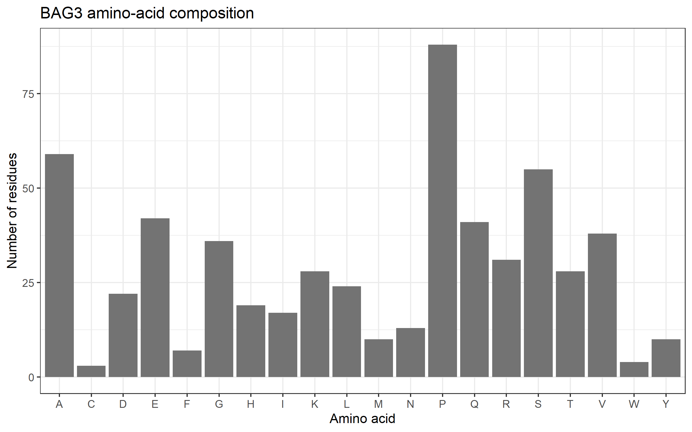
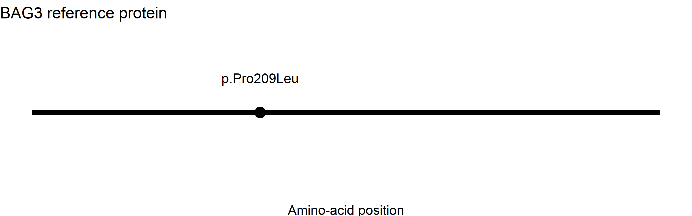
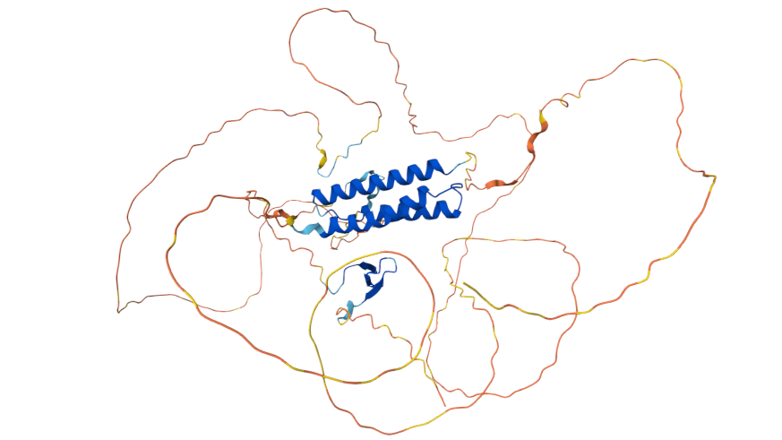

## Molecular Mechanisms of Muscle Contractility: BAG3 Variant Analysis

## Assignment Information

* *Assignment:* Molecular Mechanisms of Muscle Contractility
* *Gene:* BAG3
* *Gene name:* BAG cochaperone 3
* *NCBI Gene ID:* 9531
* *Reference transcript:* NM_004281.4
* *Reference protein:* NP_004272.2
* *ClinVar Variation ID:* 5981
* *Nucleotide variant:* NM_004281.4:c.626C>T
* *Protein variant:* NP_004272.2:p.Pro209Leu
* *Variant type:* Missense variant
* *Clinical significance:* Pathogenic
* *Protein length:* 575 amino acids

## Research Question

How does the BAG3 p.Pro209Leu variant relate to muscle disease, and how can sequence analysis, clinical variant information, and predicted protein structure help explain its possible effects?

## Background

BAG3 encodes BAG cochaperone 3, a protein involved in cellular protein quality control. It helps regulate the handling of proteins in cells. Proper protein maintenance is important in muscle cells because their structural and functional proteins must remain organized and functional.

Variants in BAG3 have been associated with muscle and heart conditions, including myofibrillar myopathy and cardiomyopathy. This project analyzes the reference BAG3 protein sequence, examines amino acid composition, records the position of the assigned variant, and reviews clinical and structural information from public databases.

## Materials and Software

* R and RStudio
* rentrez package
* ggplot2 package
* NCBI Gene, Nucleotide, and Protein databases
* ClinVar
* AlphaFold Protein Structure Database
* Microsoft Paint or another image tool for saving the structure screenshot
* GitHub for project documentation and file sharing

## Methods

## Step 1. Project setup

An R project was organized into three folders: data, results, and figures. The R analysis script was saved as muscle_contractility.R.

## Step 2. Retrieve BAG3 information

The rentrez package was used to retrieve BAG3 gene information from NCBI. The gene symbol, gene ID, and official gene name were recorded in results/gene_summary.txt.

## Step 3. Retrieve the reference protein sequence

The BAG3 reference transcript, NM_004281.4, was examined to identify its encoded protein accession, NP_004272.2. The reference protein sequence was retrieved from NCBI and saved as data/BAG3_protein.fasta. The protein accession was recorded in results/protein_accession.txt.

## Step 4. Analyze protein length and amino acid composition

The FASTA sequence was read into R. The protein length was calculated, and the frequency of each of the 20 standard amino acids was counted. The results were saved in results/amino_acid_composition.csv.

## Step 5. Create the amino acid composition figure

The ggplot2 package was used to visualize amino acid frequencies. The figure was saved as figures/01_amino_acid_composition.png.

## Step 6. Examine the assigned variant

ClinVar Variation ID 5981 was reviewed to identify the nucleotide change, protein change, clinical classification, associated conditions, and supporting publications. The findings were recorded in results/clinvar_variant_summary.txt.

The variant position was visualized in figures/02_variant_position.png. The figure illustrates the location of the variant in the protein sequence and does not independently establish its functional effect.

## Step 7. Review predicted protein structure

The AlphaFold Protein Structure Database entry for human BAG3, UniProt O95817, was reviewed. A screenshot was saved as figures/03_BAG3_structure.png. The model was treated as a computational prediction rather than an experimentally determined structure.

## Step 8. Document the project

The script, reference sequence, result files, figures, database links, and interpretation were organized for reproducibility and submission through GitHub.

## Results

## 6.1 BAG3 reference protein

The retrieved BAG3 reference protein, NP_004272.2, contains *575 amino acids*.

The amino acid composition analysis showed that proline was the most frequent amino acid, with 88 residues. Alanine was next, with 59 residues, followed by serine, with 55 residues.

These values describe the reference protein sequence and do not directly measure protein activity or disease severity.

## 6.2 Variant information

| Feature                 | Result      |
| ----------------------- | ----------- |
| Gene                    | BAG3        |
| Transcript              | NM_004281.4 |
| Nucleotide change       | c.626C>T    |
| Protein change          | p.Pro209Leu |
| Protein position        | 209         |
| Variant type            | Missense    |
| ClinVar Variation ID    | 5981        |
| Clinical classification | Pathogenic  |

The variant changes proline to leucine at amino acid position 209. ClinVar lists the variant in association with BAG3-related conditions, including myofibrillar myopathy and dilated cardiomyopathy.

## 6.3 Protein structure

The AlphaFold database provides a predicted BAG3 protein structure. Its reported average pLDDT score is 57.25, indicating low overall confidence. Therefore, the model should be interpreted cautiously, and it should not be used alone to establish the structural effect of p.Pro209Leu.

## Figures

## Figure 1. BAG3 Amino Acid Composition

This figure shows the frequency of the 20 standard amino acids in the 575-amino-acid reference BAG3 protein.

## Figure 2. BAG3 Variant Position

This figure identifies the assigned variant position in the BAG3 protein sequence. It provides positional information rather than direct experimental evidence of altered protein function.

## Figure 3. Predicted BAG3 Protein Structure

This figure documents the AlphaFold-predicted structure of BAG3. The model has low overall confidence and is not an experimentally determined structure.

## Discussion and Variant Interpretation

BAG3 encodes BAG cochaperone 3, a protein involved in cellular protein quality control. This function is important in muscle cells because muscle proteins must remain properly organized and functional. The reference protein retrieved from NCBI, NP_004272.2, contains 575 amino acids. The assigned variant, NM_004281.4:c.626C>T (p.Pro209Leu), is a missense variant that changes proline to leucine at amino acid position 209.

ClinVar currently classifies this variant as pathogenic, with nine submissions contributing to the aggregate classification. It has been reported in individuals with BAG3-related myofibrillar myopathy and cardiomyopathy. These clinical reports support an association between the variant and muscle or heart disease, but the clinical classification alone does not explain every molecular step that causes the disease.

Experimental findings provide additional evidence. Selcen et al. (2009) reported the p.Pro209Leu variant in three patients with progressive muscle weakness. Their study described abnormalities in muscle structure and abnormal aggregation of mutant BAG3 in cultured cells. These observations support the conclusion that the variant can affect protein behavior and is associated with muscle disease. However, findings from a limited number of patients and a cell-based experiment should not be treated as proof of every effect in human muscle.

The amino acid composition analysis describes the reference BAG3 protein, including its length and the frequency of each amino acid. The variant-position figure identifies the location of amino acid 209 in the protein sequence. These analyses help document the sequence and variant location, but they do not independently demonstrate pathogenicity. Likewise, the AlphaFold model is a predicted structure rather than an experimentally determined structure. Its low overall confidence means that the model should be interpreted cautiously, especially when drawing conclusions about the precise shape or interactions around residue 209.

Overall, the combination of clinical reports and published experimental findings supports the pathogenic classification of BAG3 p.Pro209Leu. The sequence analysis and figures in this project provide supporting descriptive information, not a new functional test. A useful follow-up experiment would compare wild-type and p.Pro209Leu BAG3 in an appropriate cell model, measuring protein abundance, aggregation, and relevant protein interactions under the same conditions. Replicated results with suitable controls would help determine which functional changes are directly caused by the variant.

## Limitations

This project is based on reference sequence analysis, database records, published research, and a predicted protein structure. The amino acid counts do not measure protein expression or activity. The variant-position figure does not demonstrate a molecular mechanism. The AlphaFold model has low overall confidence and cannot replace experimental structural data.

The clinical interpretation depends on the evidence available in ClinVar and the cited literature. No new laboratory experiment was performed as part of this computational analysis.

## Proposed Validation Experiment

A possible follow-up experiment would compare wild-type BAG3 with the p.Pro209Leu variant in an appropriate cell model. Protein abundance, aggregation, and selected protein interactions could be measured under the same experimental conditions. Appropriate controls and biological replicates would be necessary to determine whether observed differences are reproducible.

## Project Structure

The repository should contain the following files and folders:

text
Muscle-Contractility-BAG3/
├── README.md
├── muscle_contractility.R
├── data/
│   └── BAG3_protein.fasta
├── results/
│   ├── gene_summary.txt
│   ├── protein_accession.txt
│   ├── amino_acid_composition.csv
│   └── clinvar_variant_summary.txt
└── figures/
    ├── 01_amino_acid_composition.png
    ├── 02_variant_position.png
    └── 03_BAG3_structure.png

## Reproducibility

The analysis was performed using R with the rentrez and ggplot2 packages.

To reproduce the sequence analysis:

1. Install R and RStudio.
2. Download or clone this repository.
3. Open the project folder in RStudio.
4. Install the required packages if they are not already available:

install.packages(c("rentrez", "ggplot2"))

5. Run the analysis script:

source("muscle_contractility.R")

An internet connection is required for steps that retrieve information from NCBI. The saved ClinVar summary and AlphaFold screenshot are documentation records reviewed separately; they are not necessarily regenerated by the R script.

## Errors Encountered and Corrections

Document actual errors encountered during the analysis and the corrections made. Do not report errors that did not occur.

If no errors were encountered, state:

"No unresolved errors were identified during the final review. The script and output files should be checked by rerunning the analysis before submission."

## Data Sources and References

1. National Center for Biotechnology Information. *NCBI Gene: BAG3 (Gene ID 9531).*
   https://www.ncbi.nlm.nih.gov/gene/9531 

2. National Center for Biotechnology Information. *NCBI Nucleotide: NM_004281.4.*
   https://www.ncbi.nlm.nih.gov/nuccore/NM_004281.4 

3. National Center for Biotechnology Information. *NCBI Protein: NP_004272.2.*
   https://www.ncbi.nlm.nih.gov/protein/NP_004272.2 

4. National Center for Biotechnology Information. *ClinVar: BAG3 c.626C>T (p.Pro209Leu), Variation ID 5981.*
   https://www.ncbi.nlm.nih.gov/clinvar/variation/5981/ 

5. Selcen, D., Muntoni, F., Burton, B. K., Pegoraro, E., Sewry, C., Bite, A. V., & Engel, A. G. (2009). Mutation in BAG3 causes severe dominant childhood muscular dystrophy. *Annals of Neurology, 65*(1), 83–89.
   https://pubmed.ncbi.nlm.nih.gov/19085932/ 

6. European Bioinformatics Institute. *AlphaFold Protein Structure Database: BAG3, UniProt O95817.*
   https://alphafold.ebi.ac.uk/entry/AF-O95817-F1 

*Database access date:* October 28, 2026.

## Conclusion

This project analyzed the BAG3 reference protein sequence, summarized its amino acid composition, examined the p.Pro209Leu variant, and reviewed clinical and predicted structural information. The variant is classified as pathogenic in ClinVar and has been reported in association with muscle and heart disease. The computational analysis provides a reproducible record of the reference sequence and variant location, while further controlled experiments would be needed to investigate specific molecular effects.
